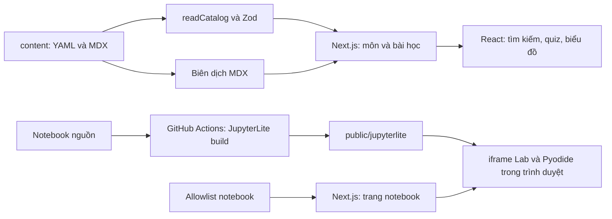

# Kiến trúc Learning Hub

Kiểm chứng bằng mã `main` tại `2b8ba89511038a0432a4818410115cb7254c1fff` ngày 26/11/2026. Kiến trúc này mô tả bản đang có, không phải thiết kế tương lai. Chưa chạy lại ứng dụng hoặc notebook trong đợt tài liệu.

## Tổng thể

Next.js App Router đọc nội dung từ filesystem của repo, kiểm tra metadata bằng YAML/Zod và dựng bài MDX. Các trang môn, bài và notebook khai báo `generateStaticParams` cùng `dynamicParams = false`. Thành phần tương tác React chạy phía trình duyệt; Python chạy trong JupyterLite/Pyodide được phục vụ dưới `public/`.

Không thấy database, API route, đăng nhập, dịch vụ lưu tiến độ hoặc Python server trong mã. `jupyter-server` là dependency của môi trường **build** runtime, không phải backend thực thi của website.

## Công nghệ và cấu hình

Các phiên bản là khai báo trong `package.json`, không phải phiên bản đã cài/kiểm tra lại:

| Thành phần | Khai báo / vai trò |
| --- | --- |
| Node.js | engines `>=24`; README/CI chọn 24 |
| Next.js, @next/mdx | `16.4.6`, App Router và biên dịch MDX |
| React / React DOM | `^19.2.3` |
| TypeScript | `^5.9.0` |
| Tailwind CSS | `4.3.3`, PostCSS |
| MDX | @mdx-js loader/react `^3.1.0`; remark-frontmatter |
| YAML / Zod | `^2.8.4` / `^4.6.5` cho metadata |
| KaTeX / Recharts | `^0.18.2` / `^3.5.0` cho công thức và biểu đồ |
| Python build | 3.12 trong GitHub Actions |
| JupyterLite core / Pyodide kernel | `0.8.7` / `0.8.7`; jupyter-server `>=2,<3`, jupyterlab `>=4,<5` |

Không có lockfile npm ở mốc đối chiếu. CI dùng `npm ci` nếu có lockfile, nếu không dùng `npm install --package-lock=false`. `next.config.mjs` mở rộng MDX và pageExtensions; không cấu hình `output: export`, nên không gọi đây là bản Next static export.

## Bản đồ thư mục

| Vị trí | Trách nhiệm |
| --- | --- |
| `app/` | Layout, CSS, trang chủ, các route môn/bài/notebook |
| `components/learning/` | Danh mục, nguồn, quiz, công thức và mô phỏng |
| `lib/content/schema.ts` | Schema strict cho YAML/frontmatter |
| `lib/content/catalog.ts` | Đọc metadata, index, kiểm tra tham chiếu và sắp xếp |
| `lib/notebooks.ts` | Allowlist 8 notebook và liên kết notebook–môn–bài |
| `mdx-components.tsx` | Đăng ký thành phần dùng trong MDX |
| `content/data-analytics/` | Metadata, 32 MDX và 8 notebook nguồn |
| `jupyterlite/` | Requirements và hướng dẫn dựng runtime |
| `public/jupyterlite/` | Runtime và bản sao notebook được sinh; không sửa tay |
| `scripts/check-content.ts` | Gọi readCatalog để kiểm tra nội dung |
| `.github/workflows/` | CI ứng dụng và workflow dựng/commit JupyterLite riêng |

## Route và luồng nội dung

| URL | Cách dựng / hành vi |
| --- | --- |
| `/` | `readCatalog()`, nhóm môn theo semesterId, học kỳ giảm dần |
| `/courses/[course]` | ID môn trong catalog; Python Lab và CourseCatalog |
| `/courses/[course]/lessons/[lesson]` | Sinh đủ cặp course/lesson; tra metadata trước khi import MDX; có nguồn và notebook liên quan |
| `/courses/[course]/notebooks/[notebook]` | Sinh từ allowlist; tham số notebook gồm đuôi `.ipynb`; từ chối cặp không hợp lệ |
| `/jupyterlite/lab/index.html?path=<filename.ipynb>` | Static Lab được nhúng và mở toàn màn hình từ trang notebook |

`readCatalog()` đọc các thư mục dưới `content`, parse bốn file YAML, trích YAML frontmatter đầu bài MDX, kiểm tra và trả về metadata; phần thân MDX được import/biên dịch riêng. Môn sắp theo tên locale `vi`, chủ đề theo order, buổi theo number, bài theo order rồi ID. Tham chiếu bài liên quan được kiểm tra xuyên môn nhưng chưa có UI hiển thị danh sách relatedLessons trên trang bài.

CourseCatalog là client component: mặc định tab chủ đề, state query/view chỉ trong phiên trang, lọc title + summary bằng lowercase vi-VN. Bộ lọc không đọc thân MDX và không lưu query vào URL. Nhóm buổi bổ sung nhóm preview cho bài không có sessionIds. Một bài có thể hiện trong nhiều nhóm và vẫn dẫn đến cùng route.

## Thành phần tương tác

| Thành phần | Hành vi thực tế |
| --- | --- |
| `Quiz` | State đáp án/đã nộp, phản hồi và lời giải; không có lưu điểm phía server |
| `MathFormula` | KaTeX renderToString, display mode, throwOnError và trust=false |
| `MeanChart` | Dãy [2,4,x], slider x và đường trung bình cập nhật |
| `NormalizationExplorer` | Min-Max hoặc Z-score từ dãy cố định [20,40,60,80,100]; slider chỉ đổi giá trị tính thử, không đổi dãy chuẩn hóa |
| `ChartTypeExplorer` | Chuyển dạng biểu đồ với dữ liệu minh họa |
| `SeriesAlignmentExplorer` | Minh họa cộng Series theo nhãn index |
| `RidgePenaltyExplorer` | Ridge đơn biến nghiệm giải tích, intercept không bị phạt, slider alpha làm đổi đường fit |
| `LessonSources` | Hiển thị tên nguồn và vị trí; khi có URL PDF thì thêm hash page; VTT chỉ hiển thị mốc, không có trình phát đồng bộ |

Các ví dụ/mô phỏng không phải dữ liệu gốc của slide. MDX được biên dịch thành mã ứng dụng; chỉ coi nội dung đã review là nội dung tin cậy để đưa vào build.

## Nội dung đang có

- Một môn `data-analytics`, 9 chủ đề, 5 buổi, không có date trong sessions.
- 32 bài: 15 gắn ít nhất một buổi và 17 đọc trước. “Gắn buổi” không bảo đảm mọi đoạn bài đã được giảng; hai bài đã ghi rõ giới hạn transcript.
- 13 khai báo nguồn: 8 PDF và 5 VTT, chưa có URL hoặc file gốc trong repo. Chỉ kiểm chứng được metadata và nơi trích dẫn, chưa kiểm chứng nguồn gốc.
- 8 notebook allowlist: 4 cho Buổi 02–05 và 4 đọc trước Bài 04–07. Mỗi notebook có bản sao giống byte trong `public/jupyterlite/files/`; execution_count của các cell code đều chưa được ghi.

## Build, thực thi và triển khai notebook

1. Nguồn `.ipynb` đặt trong `content/data-analytics/notebooks/`, liên kết bằng allowlist; cùng một notebook có thể phục vụ nhiều bài.
2. Workflow `build-jupyterlite.yml` chạy thủ công hoặc khi push main thay đổi notebook, `jupyterlite/**` hay chính file workflow. Thay allowlist đơn thuần không kích hoạt workflow này.
3. Python 3.12 cài requirements; `jupyter lite build --base-url /jupyterlite/ --contents content/data-analytics/notebooks --output-dir public/jupyterlite` sinh runtime và preload notebook.
4. Workflow kiểm tra tồn tại một số file Lab/config/notebook rồi commit output và push về main với message `[skip ci]`. Nó chưa chạy cell để chứng minh kernel hoạt động. Concurrency không hủy run đang chạy.
5. Trang notebook dùng `existsSync(public/jupyterlite/lab/index.html)` khi render để chọn iframe hay fallback. Đây là kiểm tra file cục bộ, không phải health check runtime/production.
6. Trình duyệt tải JupyterLite/Pyodide và có thể tải thêm package qua mạng. Mã Python chạy phía client; dữ liệu chỉnh sửa lưu ở trình duyệt và không tự đồng bộ GitHub hay thiết bị khác. Nên tải notebook để lưu lâu dài.

Link tải notebook hiện trỏ thẳng GitHub main và hard-code thư mục data-analytics; mở rộng nhiều môn sẽ cần xem lại phần này. Đây là giới hạn hiện hữu, không được sửa trong đợt tài liệu.

## CI và ranh giới kiểm chứng

`ci.yml` chạy cho push/PR vào develop/main: cài dependencies, lint, typecheck (`next typegen` + tsc), content check, Next build. Không có script unit/e2e riêng trong package.json. CI ứng dụng và build runtime là hai workflow độc lập; không thấy bước runtime nằm trong `npm run build`.

Lịch sử báo Vercel nhận main và tự deploy. Lần cuối được đọc báo rate limit cho SHA runtime và chưa chạy thử cell production. Không thể khẳng định website hiện đang phục vụ SHA nào hoặc JupyterLite hoạt động chỉ từ tree Git. Đề xuất hợp nhất build ở [ROADMAP.md](ROADMAP.md) chưa phải kiến trúc hiện hành.
